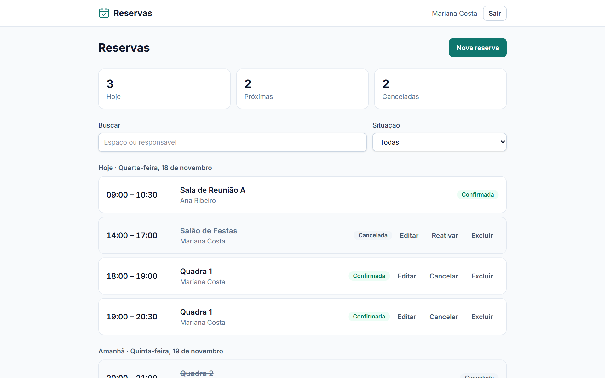
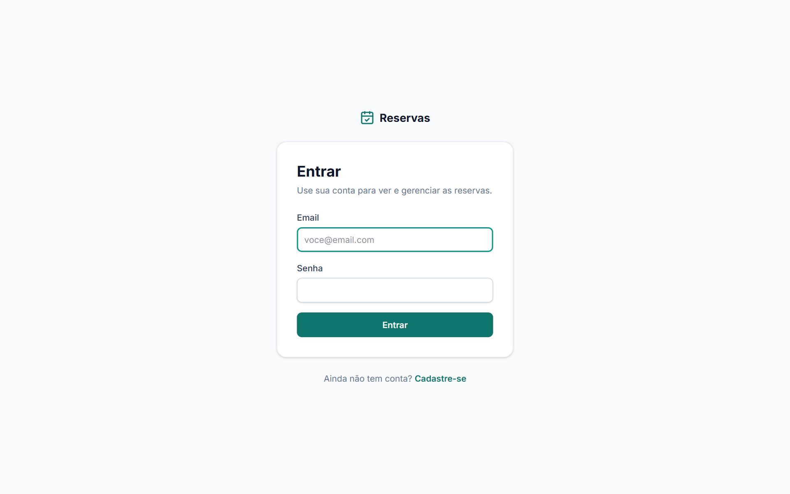
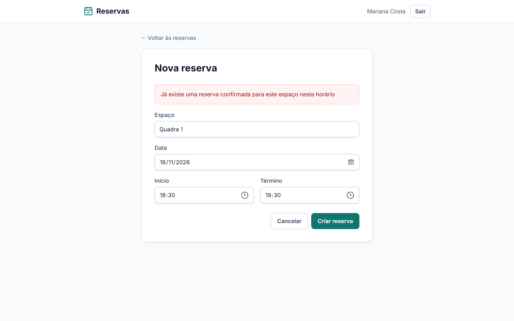
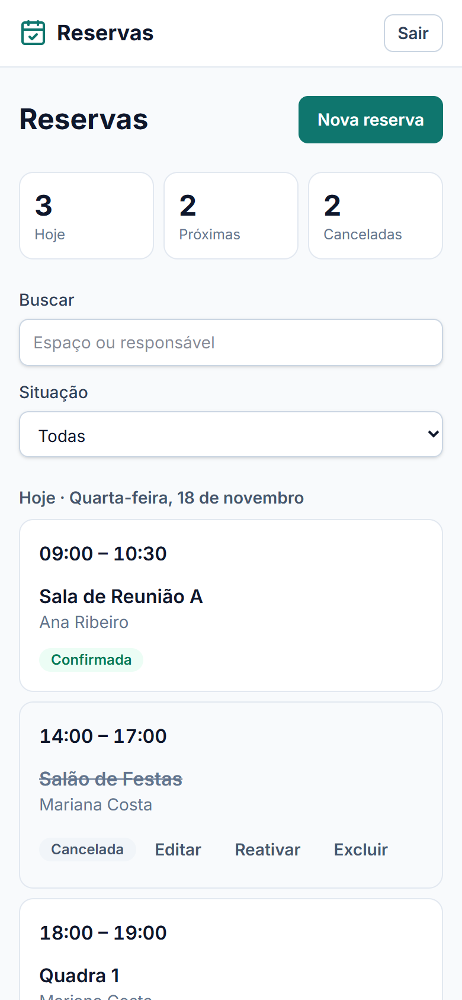

# Sistema de Reservas de Espaços

Sistema web para reservar quadras, salas e salões. Cada pessoa entra com a sua conta e cria, edita, cancela ou exclui reservas. O sistema não deixa duas reservas confirmadas no mesmo espaço e horário.

- [`backend/`](backend): API em Node, Express e MongoDB (Entrega 1, agora com login por cookie).
- [`frontend/`](frontend): interface em React e Tailwind CSS (Entrega 2).



## Tecnologias

React, TypeScript, React Router, Tailwind CSS, Vite, Node.js, Express, MongoDB (Docker), Jest e Vitest.

## Funcionalidades

- Login, logout e cadastro, com cookie de sessão.
- Páginas protegidas: sem login, a pessoa é levada para a tela de entrar.
- Reservas: listar por dia, buscar, filtrar, criar, editar, cancelar, reativar e excluir.
- O responsável é sempre quem fez a reserva. Todos veem a agenda inteira, mas cada cliente só altera as próprias reservas.
- O administrador altera todas e, ao editar, pode mudar quem é o responsável pela reserva.
- Aviso quando o horário já está ocupado.
- Mensagens de sucesso, erro e carregamento. Funciona no computador e no celular.

## Como executar

Precisa de [Node.js](https://nodejs.org) 20 ou mais e do Docker Desktop aberto. Use três terminais.

```bash
# 1. Banco de dados
cd backend
docker compose up -d
```

```bash
# 2. API (http://localhost:3000)
cd backend
npm install
cp .env.example .env
npm run seed
npm run dev
```

```bash
# 3. Interface (http://localhost:5173)
cd frontend
npm install
cp .env.example .env
npm run dev
```

No Windows, se o PowerShell bloquear o `npm`, use `npm.cmd`. No `cmd`, o `cp` é `copy`.

## Variáveis de ambiente

Cada projeto tem um `.env.example` para copiar para `.env`.

| Arquivo | Variável | Para que serve |
| --- | --- | --- |
| `backend/.env` | `MONGODB_URL` | Conexão com o MongoDB |
| `backend/.env` | `PORTA` | Porta da API (3000) |
| `backend/.env` | `ORIGENS_PERMITIDAS` | Endereços do frontend aceitos nas escritas |
| `frontend/.env` | `API_PROXY_TARGET` | Endereço da API (`http://localhost:3000`) |

## Como usar

O `npm run seed` cria duas contas de exemplo:

| Perfil | Email | Senha |
| --- | --- | --- |
| Cliente | `mariana@email.com` | `senha123` |
| Administrador | `admin@reservas.com` | `admin123` |

1. Abra `http://localhost:5173` e entre com uma das contas, ou crie a sua em **Cadastre-se**.
2. Clique em **Nova reserva**. Se o horário já estiver ocupado, o sistema avisa.
3. Nas suas reservas, use **Editar**, **Cancelar** (libera o horário) ou **Excluir**. Nas dos outros, esses botões não aparecem. Entre como administrador para mexer em todas e trocar o **Responsável** ao editar.
4. Clique em **Sair**. Ao tentar abrir uma página interna, você volta ao login.

A documentação da API (Swagger) fica em `http://localhost:3000/documentacao`.

| Login | Horário ocupado | Celular |
| --- | --- | --- |
|  |  |  |

## Como funciona o login por cookie

- `POST /login` confere email e senha, cria uma sessão no servidor e devolve o cookie `sessao`.
- O cookie é HttpOnly (o JavaScript não lê) e a sessão expira após 30 minutos sem uso.
- O navegador envia o cookie sozinho. As rotas de reservas respondem 401 sem ele.
- Ao recarregar a página, o frontend chama `GET /sessao` para saber se ainda há login.
- `POST /logout` apaga a sessão e o cookie.

## Organização do projeto

```
backend/src      routes, middlewares, controllers, services, repositories, models
frontend/src
  paginas/       uma por tela (Login, Cadastro, ListaReservas, FormularioReserva)
  componentes/   peças reutilizáveis (botão, campo, modal, item da lista...)
  contextos/     login e avisos
  servicos/      chamadas à API
  utilitarios/   datas, filtros e validações
```

## Testes

```bash
cd backend && npm run test:tudo
cd frontend && npm test
```
